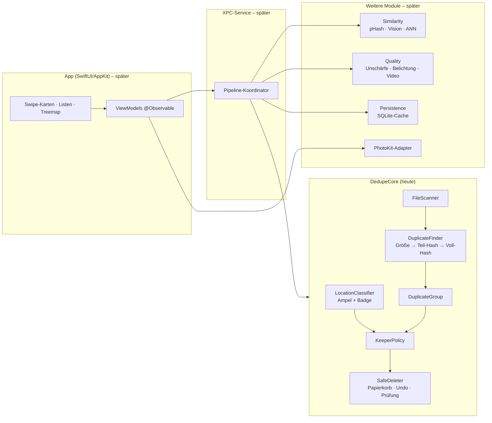

# Architektur – Dedupe & Swipe

Stand: Schritt 1 (Entwurf) und Beginn von Schritt 2 (Hash-Spike). Grundlage ist [PROMPT.md](../PROMPT.md).

## Überblick

## Module

| Modul | Aufgabe | Status |
|---|---|---|
| `DedupeCore` | Scan, exakte Duplikate, Speicherort-Ampel, Breadcrumb, Vorauswahl, sicheres Löschen | Schritt 2, ungetestet auf macOS |
| `DedupeCLI` | Headless-Scan und Benchmark-Tabelle | Schritt 2 |
| `Similarity` | Ähnlichkeit 0–100 % je Kategorie, ANN-Index, Union-Find | Schritt 3 |
| `Persistence` | Cache für Hashes, Embeddings, Thumbnails, Pfad-Metadaten (SQLite/WAL) | Schritt 3/6 |
| `PhotosAdapter` | Fotos-Mediathek über PhotoKit (ADR 0002) | Schritt 3/4 |
| `Quality` | Qualitäts-Score Foto/Video mit Gründen | Schritt 5 |
| `App` + XPC | UI, Swipe-Review, Hintergrund-Pipeline | Schritt 4/6 |

## Datenfluss exakte Duplikate (heute)

1. **Scan** (`FileScanner`): `FileManager`-Enumerator mit vorab geladenen Resource-Keys, überspringt versteckte Dateien, Pakete und Ausschlussordner. Symlinks werden gezählt, aber nicht gehasht. Pro Datei ein `lstat` → `FileRecord` (Pfad, Größe, mtime, Gerät, Inode).
2. **Hardlinks** zusammenfassen über (Gerät, Inode). Sie belegen keinen zusätzlichen Platz und werden in der Gruppe separat angezeigt.
3. **Größenfilter** ohne I/O. Nur Größen mit mindestens zwei Dateien bleiben übrig.
4. **Teil-Hash** über Größe + erste/letzte 64 KiB. Bei Dateien ≤ 128 KiB ist das bereits der ganze Inhalt, also das Endergebnis.
5. **Voll-Hash** (SHA-256, 1-MiB-Puffer, `F_NOCACHE`) nur für die übrigen Kandidaten.
6. **Klassifizierung** jeder Fundstelle: Badge (Speicherort-Typ) und Ampel mit Klartext-Grund. Volume-Infos werden pro Datenträger einmal nachgeschlagen (`VolumeCache`).
7. **Vorauswahl** (`KeeperPolicy`): Master-Ordner → Ampel → älteste → kürzester Pfad. Rot ist immer gesperrt.
8. **Aktion** (`SafeDeleter`): Ampel prüfen → Datei unverändert? (Inode, Größe, mtime) → Papierkorb → Beleg für Undo.

Parallelität: Teil- und Voll-Hash laufen mit höchstens `activeProcessorCount` gleichzeitigen Aufgaben (`concurrentCompactMap`). Abbruch über Task-Cancellation.

## Ähnlichkeit 0–100 % (Entwurf für Schritt 3)

- Pro Kategorie ein Plugin mit `fingerprint(file) -> Vektor/Hash` und `distance(a, b) -> 0…1`.
- Regler-Wert *s* entspricht der Distanzschwelle *d = 1 − s*, kalibriert pro Kategorie an einem Testdatensatz (Precision/Recall-Kurve).
- **Einmal** beim Scan: Nachbarschaftsgraph mit Kanten bis zur größten sinnvollen Distanz aus dem ANN-Index (BK-Tree für Hamming-Hashes, HNSW für Embeddings).
- **Pro Regler-Bewegung**: Kanten mit Distanz ≤ *d* filtern, Gruppen per Union-Find bilden. Das ist reine Speicherarbeit und hält das Ziel von unter 100 ms ein.

## Speicherort-Transparenz

- `Breadcrumb`: `Macintosh HD › Users › … › Urlaub 2024 › IMG_0421.jpg`. Anfang und Ende bleiben immer sichtbar, voller Pfad für Klick und VoiceOver.
- `LocationKind` (Badge): intern, extern, Netzwerk, iCloud Drive, Cloud-Ordner mit Anbieter, Fotos-Mediathek, Papierkorb, System.
- `TrafficLight` mit Symbol und Text, Regeln in ADR 0004.
- Alles wird beim Scan berechnet. Beim Scrollen fällt kein I/O an.

## Offene Punkte und bekannte Grenzen des Spikes

- **Noch nicht auf macOS kompiliert.** Die Cloud-Umgebung hat keinen Swift-Compiler, Build und Tests laufen auf dem Mac.
- Der Scan sammelt alles in einem Array. Für Millionen Dateien folgt Streaming mit `getattrlistbulk` und Backpressure in die Hash-Stufen.
- Blockierendes I/O läuft im kooperativen Thread-Pool, begrenzt auf die Kernzahl. Später kommt ein eigener I/O-Pool bzw. der XPC-Service.
- APFS-Clones werden noch nicht erkannt (`getattrlist` mit `ATTR_CMNEXT_CLONEID`). Bis dahin kann „freigebbar" bei geklonten Dateien zu hoch sein.
- Es gibt noch keinen persistenten Cache und keine FSEvents. Jeder Scan beginnt von vorn.
- Das Aktionsprotokoll ist vorbereitet (`TrashReceipt` ist `Codable`), aber noch nicht auf die Platte geschrieben.
- Die Strategie unterscheidet noch nicht zwischen SSD, HDD und Netzlaufwerk (auf HDD weniger Parallelität).
